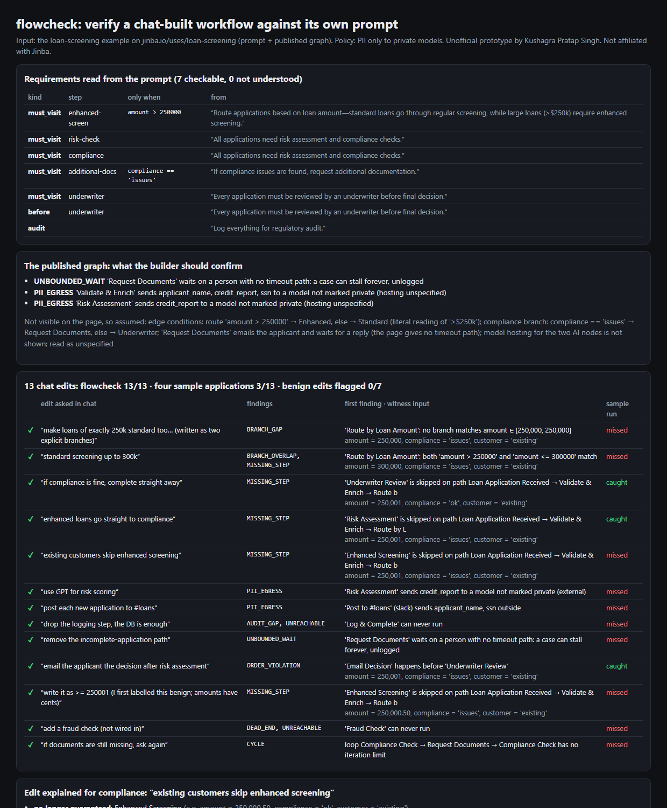

# flowcheck: verify a chat-built workflow against its own prompt

Jinba lets business teams "describe workflows in plain language and deploy them to production". Its loan-screening use case ([jinba.io/uses/loan-screening](https://jinba.io/uses/loan-screening)) shows the prompt:

> "…large loans (>$250k) require enhanced screening. All applications need risk assessment and compliance checks. If compliance issues are found, request additional documentation. Every application must be reviewed by an underwriter before final decision. Log everything for regulatory audit."

In a bank, the people who sign off are compliance, not the builder. After the fifth chat edit ("existing customers can skip enhanced screening"), nobody re-reads the YAML. The questions they need answered:
- Does every path still satisfy the sentences above?
- Where's the gap at exactly $250,000?
- Did PII just reach a model that isn't private?

`flowcheck` answers them, with a concrete input for every finding.



## What it does

| Part | What |
|---|---|
| `reqs.py` | Reads the prompt's requirement sentences into checks: *must visit* (optionally *only when* `amount > 250000` / `compliance == 'issues'`), *X before decision*, *audit every path*. Any sentence with must/need/every/only that no pattern understands is listed as **not checked**, never silently passed. |
| `model.py` | Enumerates every path through the workflow graph with a **symbolic input** (intervals for amounts, sets for enums), resolving `else` as the complement of its siblings. Event edges (reply/timeout) are explored too. |
| `check.py` | Findings, each with a witness input:<br>**Branches:** `BRANCH_GAP` (no branch matches amount = 250,000) and `BRANCH_OVERLAP`.<br>**Requirements:** `MISSING_STEP` and `ORDER_VIOLATION` (decision before the underwriter).<br>**Audit and waits:** `AUDIT_GAP`, `UNBOUNDED_WAIT` (a human wait with no timeout path).<br>**Graph shape:** `CYCLE` (no iteration limit), `UNREACHABLE`, `DEAD_END`.<br>**Privacy:** `PII_EGRESS` (PII to a model not marked private, or to Slack/email/HTTP beyond an allow-list). |
| `diff.py` | Explains an edit for compliance: for which inputs a step is **no longer guaranteed** or **now always runs**, with an example input. |
| `baseline.py` | What a typical pre-deploy test would catch: 4 sample applications (100k / 500k × compliance ok / issues) checked against the same requirements. |

## Results

**Jinba's published example.**
- All **7 requirements** in the prompt are understood; **0 not checked**.
- With a "PII only to private models" policy, it raises **3 questions for the builder** on the published graph:
  - "Request Documents" waits on the applicant with no timeout path, so a case can stall unlogged.
  - Two AI nodes receive applicant and credit data, and their hosting isn't shown.
- The page doesn't show edge conditions or model hosting. The demo fills them with the literal reading of the prompt and **prints every assumption** next to the result.

**13 chat edits** to a clean version of the same flow (written by me to mimic LLM edit mistakes), plus 7 benign edits:

| | caught | benign edits flagged |
|---|---|---|
| **flowcheck** | **13/13** (exact expected findings) | **0/7** |
| 4 sample applications | 3/13 | 0/7 |

The sample run misses every boundary bug:
- `>` vs `<`, which leaves exactly 250,000 unrouted
- an overlap up to 300k
- an "existing customers skip enhanced screening" fast lane
- `>= 250001`, which skips 250,000.50

It also misses every privacy, audit and wait problem.

**One mistake of my own:** I first labelled `amount >= 250001` a harmless rewrite. flowcheck flagged it with the witness `amount = 250,000.50`. Amounts have cents, so the label was wrong, not the checker; it's now in the mistake set.

## Run

```bash
python demo.py                 # → out/report.html, out/report.json   (stdlib only)
python -m pytest -q            # 7 tests
```

## Honest limits

- **My own format, not Jinba's.** The workflow is a small JSON/YAML-like structure I wrote, with the node and edge layout copied from the published diagram. Wiring it to Jinba's real YAML needs their schema.
- **Simple conditions only:** one numeric field compared with a constant, enum (in)equality, `and`. Free-form code or LLM-decided branches can't be analysed this way; they'd be flagged as opaque.
- **The prompt reader is pattern-based**, covering the phrasings in this prompt plus close variants. Anything else shows as *not checked*. An LLM could propose requirements, but a person should confirm them.
- **The edit set is hand-written** to mimic plausible mistakes. These aren't logged Jinba edits.
- Nothing here touched Jinba's product or systems.

Unofficial prototype by Kushagra Pratap Singh. Not affiliated with Jinba.
